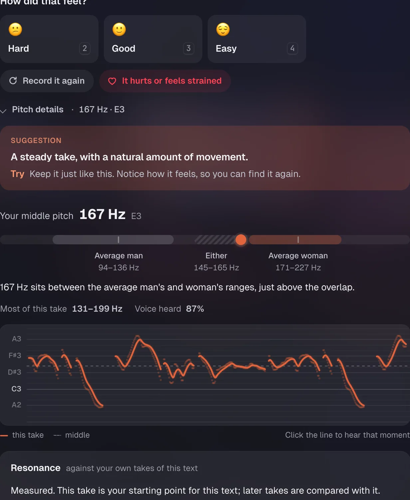

# Lilt

A small, private app for practising your voice out loud, a few minutes a day. Read a short text,
watch your pitch live, listen back, try again. Every recording stays on your computer, so in a month
you can hear how far you've come.


## What it does

- **A cosy room to practise in.** Today's cards sit in a stack; sit down at the computer to start.
- **Courses in plain Markdown.** One skill per chapter, explained first, with a check-in text you
  repeat each visit. The first course is voice training: warm-ups, pitch, resonance, weight,
  intonation, then everyday speech.
- **Spaced practice, rated by you.** Cards come back on a schedule your own rating sets. Numbers never grade you.
- **Measured, then described in words.** Praat measures pitch and resonance; Lilt says what it heard
  and suggests one thing to try.
- **Your progress over time.** Compare any take with your first one, or see every take of a text on one line.
- **Make it yours.** Remix a chapter by asking your AI (ChatGPT, or any agent over MCP). Every change can be undone.

| Practise a text, A/B with last time | What a take measured |
| --- | --- |
|  |  |


## Quick start

macOS, with Rust, Node + pnpm and [uv](https://docs.astral.sh/uv/) installed:

```bash
./lilt.sh
```

Or with Docker:

```bash
docker compose up -d --build
```

Then open <http://127.0.0.1:7878>. The first run builds everything; later runs start straight away.
Data lives in `~/Lilt/data` (Docker: `./lilt-data`), and Lilt only listens on your own computer.

## Good to know

- **Not a clinical tool.** It doesn't diagnose, score you or replace a speech and language therapist.
- **Everything is yours.** Recordings are ordinary audio and JSON files; Recordings → Export all makes a full copy.
- **More:** the [guide](docs/guide.md) (every feature, MCP, other devices, settings, troubleshooting,
  tests), [writing a course](docs/courses.md), [tech stack](docs/tech-stack.md) and
  [what's been verified](VALIDATION.md). Contributions are welcome.

## Content and licensing

The practice texts (the chapters and today's text cards) are Markdown files in `content/courses/voice`,
one per chapter, so you can edit them in any editor or as an Obsidian vault without touching code.
[content/courses/voice/README.md](content/courses/voice/README.md) explains the format. Restart Lilt after editing
(with Docker, `docker compose up -d --build`).

The exercise texts in `content/exercises` are short paraphrases of NHS Fife Speech and Language Therapy
patient-advice pages, with links to the originals. NHS Fife permits use for private study and personal
use only, so keep this repository private and don't redistribute that content. The status of every
exercise is `source_checked`: an AI checked it against its source, and no clinician has reviewed it.
