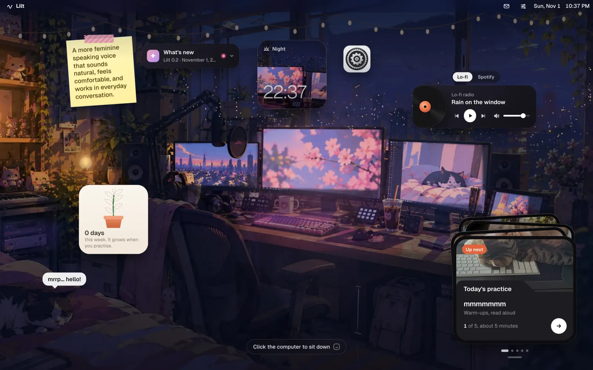
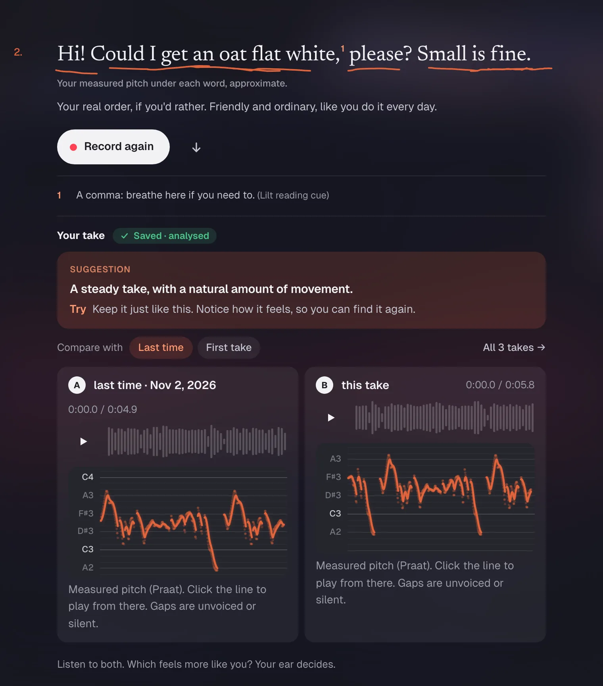
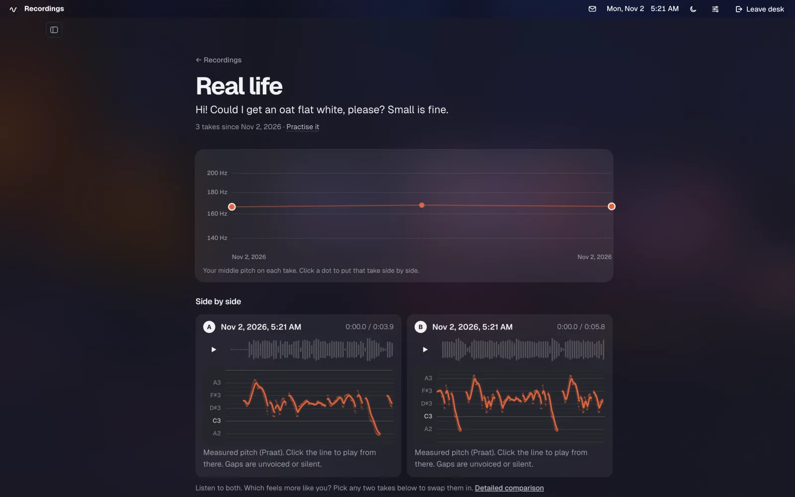

# Lilt

A small, private app for self-directed courses. Practise a few minutes a day at your own pace:
record yourself, listen back, try again. Courses are plain Markdown you can write or remix, practice
comes back on a schedule you set, and every recording stays on your computer.



## What it does

- **A cosy room to practise in.** Today's cards sit in a stack; sit down at the computer to start.
- **Courses you can write.** A course is a folder of Markdown chapters, each explaining one skill
  before you practise it, with a check-in you repeat every visit so change shows over time.
- **Spaced practice, rated by you.** Cards come back on a schedule your own rating sets. Nothing grades you.
- **Record, listen, compare.** Each take is measured and described in plain words, with one thing to
  try next. Put it beside your first take, or see every take of a text on one line.
- **Make it yours.** Remix any chapter by asking your AI (ChatGPT, or any agent over MCP). Every change can be undone.

| Practise a text, then compare with last time | One text over time |
| --- | --- |
|  |  |

## Quick start

macOS, with Rust, Node + pnpm and [uv](https://docs.astral.sh/uv/) installed:

```bash
./lilt.sh
```

Or with Docker:

```bash
docker compose up -d --build
```

Then open <http://127.0.0.1:7878>. The first run builds everything; later runs start straight away.
Data lives in `~/Lilt/data` (Docker: `./lilt-data`), and Lilt only listens on your own computer.

## Good to know

- **Private by default.** Takes are ordinary audio and JSON files; Recordings → Export all makes a full copy.
- **Describes, never diagnoses.** Lilt isn't a clinical tool and doesn't score you.
- **Write a course:** see [docs/courses.md](docs/courses.md). Course texts live in `content/courses`.
- **More:** the [guide](docs/guide.md) (every feature, MCP, other devices, settings, troubleshooting,
  tests), the [tech stack](docs/tech-stack.md) and [what's been verified](VALIDATION.md). Contributions are welcome.
- **Licensing:** the bundled exercise texts paraphrase NHS Fife patient-advice pages, which allow
  personal use only. See [content and licensing](docs/guide.md#content-and-licensing).
