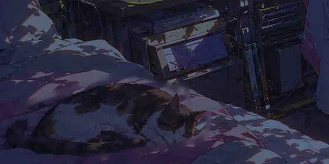

# Hey girlies, welcome in

Pull up a chair. This is a small, quiet room for working on your voice: a few minutes a day, out
loud, at your own pace. Nobody's listening but you (and the cat, who is asleep).

## Why this exists

I built Lilt for myself, because I'm terrible at discipline. The good stuff is all out there:
YouTube coaches, Reddit threads, voice guides, NHS leaflets. But it's spread across a hundred tabs,
and most nights I spent my practice time hunting for what to practise. So I pulled the pieces I
trusted into one place, put them in an order that builds slowly, and made it something I can open
and just start.

## Where I'm at

I'll be straight with you: I don't have the voice I'm working towards yet. Lilt is a structure I've
put together, not a method that's been proven to work, on me or on anyone. What it does give you is
a habit you can keep and an honest record. Every take is saved, so in a month you can listen back
and hear the change for yourself instead of guessing.

## How it works

- **Today** is a handful of cards. Say one, listen back, and tell Lilt how it felt. That decides
  when it comes back: _Again_ in a few minutes, _Hard_, _Good_ or _Easy_ a little later each time.
- **[Start here](#/studio/start-here)** first: set up your mic and record your "before".
- **Chapters**: one skill at a time (warm-ups, pitch, resonance, weight, melody), then all of it
  together, all the way to phone calls. Stay until it feels easy; go back whenever. Not a speedrun.
- **Check-ins**: one text per chapter, same words every visit, so you can hear the glow-up.
- **Free recording**: just talk. You'll get your pitch line back.
- **The recorder** draws your pitch live with your comfy range behind it, and after a take shows your
  pitch and how your resonance has moved. Pitch is only part of it; resonance, weight and melody
  matter just as much.

## Be gentle with your voice

It should never hurt. Keep the effort low, sip water, and take breaks. Some days your voice won't
cooperate; that's normal, not a step back. If speaking hurts, or you're hoarse for more than a
couple of days, stop and see a GP or a speech and language therapist. Plenty of them offer
gender-affirming voice support. Lilt is a practice tool, not a medical one.

## Make it better

If you've already found your voice, or you coach or teach this, I'd love your help. Every chapter
is a plain Markdown file, so you can fix an exercise, add a chapter or tell me where I've got it
wrong without writing any code. Contributions are welcome on [GitHub](https://github.com/G9000/lilt).

## Sources

Every exercise is written in Lilt's own words, from ideas in the guides below, so you can read the
originals. Checked on 29 October 2026.

- NHS Fife Speech and Language Therapy, [Supporting you to find your authentic voice](https://www.nhsfife.org/services/all-services/speech-and-language-therapy/supporting-you-to-find-your-authentic-voice/)
  (November 2023): breathing, pitch, resonance, vocal cords, intonation and articulation "tuning in"
  activities, and [the progression activities](https://www.nhsfife.org/services/all-services/speech-and-language-therapy/supporting-you-to-find-your-authentic-voice/activities-to-shape-your-authentic-voice/progression-activities-to-shape-your-authentic-voice/)
  that set the order of the later chapters.
- NHS Fife, Shaping your voice: [pitch and resonance](https://www.nhsfife.org/services/all-services/patient-advice/shaping-your-voice-lighten-brighten-pitch-and-resonance/),
  [articulation](https://www.nhsfife.org/services/all-services/patient-advice/shaping-your-voice-lightenbrighten-articulation/)
  and [intonation](https://www.nhsfife.org/services/all-services/patient-advice/shaping-your-voice-lighten-brighten-intonation/).
- NHS Fife, [How to take care of your voice](https://www.nhsfife.org/services/all-services/speech-and-language-therapy/how-to-take-care-of-your-voice/).
- NHS Lothian, Voice and Communication Therapy for Trans and Non-binary People:
  [What is it?](https://policyonline.nhslothian.scot/wp-content/uploads/2026/02/Voice-and-Communication-Therapy-for-Trans-and-Non-binary-People-What-is-it.pdf)
  and [Where to start](https://policyonline.nhslothian.scot/wp-content/uploads/2026/02/Voice-and-Communication-Therapy-for-Trans-and-Non-binary-People-Where-to-start.pdf)
  (February 2026): warm-ups, relaxation, voice care and vocal weight.
- NIDCD, [Taking care of your voice](https://www.nidcd.nih.gov/health/taking-care-your-voice).
- Research behind the "one skill at a time" order: Leung, Oates and Chan (2018), [a review of what
  listeners use to hear a speaker's gender](https://pubmed.ncbi.nlm.nih.gov/29392290/) (pitch,
  resonance, loudness, articulation and intonation all play a part), and Leung, Oates, Chan and Papp
  (2021), [on resonance and pitch](https://pubmed.ncbi.nlm.nih.gov/34232704/).

NHS Fife allows its material for private study and personal use. An AI checked each exercise against
its source; no clinician has reviewed this course. If you're a speech and language therapist or a
voice coach and spot something wrong, I'd really like to hear it.
